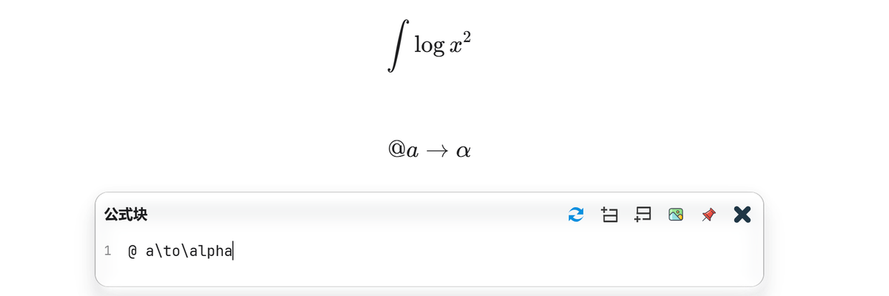

# Latex Suite

**在思源笔记中，用更少的按键写公式。**

将 `@a` 变成 `\alpha`，将 `x/` 变成分数，用 Tab 填写模板、跳出括号、输入矩阵。Latex Suite 为思源原生公式编辑器提供可定制的输入增强，也适配“数学增强”插件的 MathLive 编辑器。

[English](README.md) · [使用指南](https://github.com/eonewg/siyuan-latex-suite/blob/main/docs/guide.zh-CN.md) · [下载最新版本](https://github.com/eonewg/siyuan-latex-suite/releases/latest) · [问题反馈](https://github.com/eonewg/siyuan-latex-suite/issues)



## 从这几个输入开始

安装并启用后，使用默认配置即可尝试：

| 在哪里 | 输入 / 操作 | 结果 |
| --- | --- | --- |
| 正文 | 键入 `mk` | 创建行级公式并打开编辑器 |
| 空段落 | 键入 `dm` | 创建公式块并打开编辑器 |
| 公式编辑器 | 键入 `@a` | 自动展开为 `\alpha` |
| 公式编辑器 | 键入 `xsr` | 自动展开为 `x^{2}` |
| 公式编辑器 | 键入 `x/` | 生成 `\frac{x}{}`，光标进入分母 |
| 公式编辑器 | 键入 `pmat` 或 `bmat` | 插入圆括号或方括号矩阵模板 |
| 公式编辑器 | 选中表达式后按 `U` | 添加下花括号，并填写注释 |

`Tab` / `Shift+Tab` 用于停靠点导航和双向跳出；矩阵内用 `Tab` 换列、`Enter` 换行。默认全局开关是 `Alt+Shift+L`，macOS 为 `Option+Shift+L`。

更多触发词可在插件设置中点击“打开片段速查”，或在命令面板搜索 **Latex Suite 片段速查**。速查展示你当前保存的配置，支持搜索和类型筛选。

## 能做什么

| 能力 | 使用方式 |
| --- | --- |
| **200 余条内置片段** | 覆盖希腊字母、上下标、常用运算、矩阵及选区变换；支持自动或手动展开 |
| **模板与停靠点** | 按编号填写参数、设置默认值；原生源码框支持同编号内容联动 |
| **分数与括号** | 把光标前的表达式或选区转为分数，跳过闭合括号，按内容自动放大括号 |
| **矩阵与对齐环境** | 换列、换行和退出导航；优先跳出单元格里的括号，保留多行缩进 |
| **自定义规则** | 字符串、正则、动态函数、触发器变量，以及按宏参数限定或排除展开范围 |
| **快捷键配置** | 9 项输入及导航动作独立改键、留空禁用，片段还可设置自己的快捷键 |

输入法组合期间默认暂停展开，提交后再处理。配置保存失败时继续使用原配置；出错的动态片段单独跳过，避免阻断其他规则。

## 安装与更新

要求 **思源笔记 3.8.0 或更高版本**。使用原生公式编辑器时无需安装其他插件；MathLive 由“数学增强”插件提供。

### 从集市安装

1. 打开思源“设置 → 集市 → 插件”，搜索 **Latex Suite**。
2. 下载后，在“已下载”中启用插件。
3. 打开公式编辑器，尝试上面的输入。

集市更新由官方索引定期同步。若暂时看不到新版本，可稍后重启思源刷新，或从 GitHub 手动安装。

### 手动安装

在 [Releases](https://github.com/eonewg/siyuan-latex-suite/releases/latest) 下载 **`package.zip`**，将其中的文件直接解压至工作空间的：

```text
data/plugins/siyuan-latex-suite/
├── plugin.json
├── index.js
├── index.css
└── ...
```

然后在“设置 → 集市 → 已下载”中启用插件。升级前可先停用插件，复制保存自定义片段和变量，再覆盖程序文件并重新启用。请下载 `package.zip`；GitHub 自动生成的 Source code 压缩包需要自行构建。

## 使用文档

- **[完整使用指南](https://github.com/eonewg/siyuan-latex-suite/blob/main/docs/guide.zh-CN.md)**：公式输入流程、全部默认快捷键、矩阵操作、自定义片段、设置和常见问题。
- **[从 0.2.x 升级](https://github.com/eonewg/siyuan-latex-suite/blob/main/docs/guide.zh-CN.md#从-02x-升级)**：`t` / `T` 差异、配置保留与上游片段迁移。
- **[更新日志](CHANGELOG.md)**：按版本查看功能与修复。
- **[Obsidian 对齐记录](UPSTREAM_ALIGNMENT.md)**：已移植能力、宿主差异和验证边界。

从 Obsidian LaTeX Suite 迁移时，可以复用受支持的片段语法，但不能直接复用依赖 Obsidian API 的函数。源码框与 MathLive 的占位符行为存在差异；Conceal、彩色括号和 CodeMirror 专用功能尚未适配。兼容目标与实际验证范围详见对齐记录。

## 开发与反馈

```bash
npm ci
npm run check
npm run package
```

`check` 执行类型检查、测试与构建；`package` 生成可安装的 `package.zip`。另有 `npm run benchmark` 和 [独立浏览器夹具](tests/browser-harness.html)，运行方式见[指南](https://github.com/eonewg/siyuan-latex-suite/blob/main/docs/guide.zh-CN.md#开发验证)。

遇到问题时，请在 [Issues](https://github.com/eonewg/siyuan-latex-suite/issues) 附上思源与插件版本、使用的编辑器、最小触发步骤和相关片段。自定义配置请只保留与问题有关的部分。

## 致谢与许可

本项目的片段语法与输入流程受到 [Obsidian LaTeX Suite](https://github.com/artisticat1/obsidian-latex-suite) 启发。感谢 [artisticat1](https://github.com/artisticat1) 与上游贡献者。本项目是独立的思源插件，归属与许可信息见 [第三方声明](THIRD_PARTY_NOTICES.md)。

[MIT License](LICENSE) © 2026 eonewg
